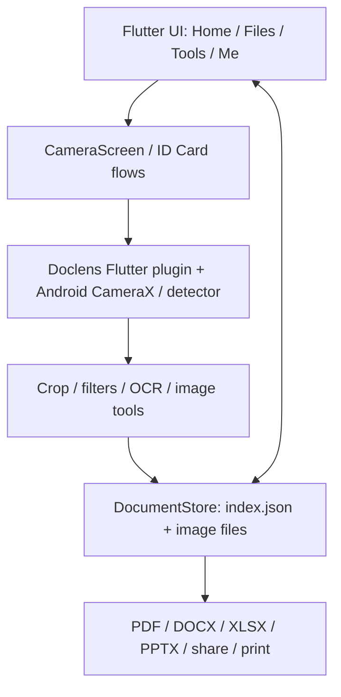
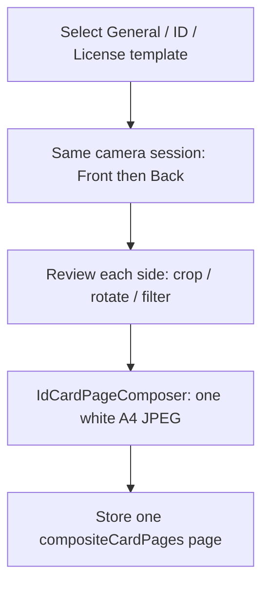

# DocScanner — Architecture

**Baseline:** Flutter `0.5.10+24` / Android-first / local document storage. This document describes **implemented code**, not a proposed cloud architecture.

## Component map



## Source layout

| Path | Responsibility |
| --- | --- |
| `lib/main.dart`, `lib/src/app.dart` | Flutter entry point, app lifecycle, theme |
| `lib/src/screens/home_shell.dart` | Home/Files/Tools/Me shell, top-level navigation |
| `lib/src/screens/camera_screen.dart` | Native scan route; Single, Batch, ID camera, gallery/settings integration |
| `lib/src/screens/id_card_template_screen.dart` | Six-template reference carousel / preview |
| `lib/src/screens/id_card_screen.dart` | General or front/back review, editing and save |
| `lib/src/services/id_card_page_composer.dart` | Creates a single A4 raster image from two card-side images |
| `lib/src/screens/crop_screen.dart` | Adjustable 4-point crop + warp confirmation |
| `lib/src/screens/document_detail_screen.dart` | Saved-document thumbnail grid, Add Pages, More, sharing |
| `lib/src/screens/document_screen.dart` | Individual page edit and actions |
| `lib/src/screens/files_workspace.dart` | Folder/document list, sort/search, selection actions |
| `lib/src/storage/document_store.dart` | Local document/folder index and copied image files |
| `lib/src/models.dart` | `ScanDocument`, `ScanPage`, `DocumentFolder`, `DocumentKind` |
| `lib/src/services/document_edges.dart` | Bridge to detection/auto-crop for imported pictures |
| `lib/src/services/image_processor.dart` | Raster filters, manual perspective warp, rotation |
| `lib/src/services/document_export.dart` | PDF, Gallery, Android share/print integration |
| `lib/src/services/docx_export.dart`, `xlsx_export.dart`, `pptx_export.dart` | Local Office OpenXML exports |
| `lib/src/services/scan_settings_store.dart` | Persisted camera settings |
| `third_party/doclens/` | Vendored, locally patched scanning plugin; Dart + native implementations |
| `tool/` | Build-host bootstrap, OCR model bundling, Gradle compatibility patches |
| `test/`, `third_party/doclens/android/src/test/` | Flutter and native regression tests |

## Regular scan sequence

1. `HomeShell` pushes `CameraScreen`.
2. `CameraScreen` embeds `DoclensScreen` and native preview through `DoclensView`/controller.
3. The detector proposes four document corners; the app shows the live outline and captures on a **manual shutter**. Camera UI Single/Batch switching is normally a Flutter-state change without recreating CameraX.
4. The capture review allows acceptance, retake and corner editing. Unreliable auto-crops should be reviewed manually; never blindly trust a guessed quad.
5. `DocumentStore.createFromPaths()` copies accepted images to app storage and writes an index entry. The document grid/editor then operates on those local pages.

Camera configuration changes that affect native warp behavior may require a controlled camera rebind. Opening another camera owner (for example, a separate ID capture) must release the current owner first. See [DECISIONS.md](DECISIONS.md#adr-004--avoid-camera-rebind-on-mode-only-changes).

## ID Card / Driver License sequence



- **General:** uncapped batch in the card-style camera; individual captures become separate document pages (`DocumentKind.document`).
- **Two-sided templates:** `cardCaptureLimit=2`; after first accepted image the UI labels the next side **Back**; after second acceptance the camera returns both paths. `IdCardScreen` creates a **single** A4 JPEG containing both sides.
- `ScanDocument.compositeCardPages=true` distinguishes new A4-composite documents from legacy two-raw-image card documents. This is serialized in the JSON index.
- `DocumentExport.toPdf` exports each composite A4 page as one full page. The legacy non-composite, two-sided export branch retains its prior layout. Adding another front/back pair produces a new composite sheet.
- The original front/back inputs are held in the unsaved review session; once a composite is saved, the document page stores the rendered A4 image. Preserving both individual sides for later re-editing is a separate follow-up in [TODO.md](TODO.md).

## Local data model and persistence

`DocumentStore.initialize()` uses Flutter's `getApplicationSupportDirectory()`:

```text
<app-support>/docscanner/
  index.json                 JSON schema marker = 1
  images/
    <uuid>.jpg | .png | ... Stored page/original copies
```

The index contains documents, their page IDs, paths, timestamps, kind, folder relationships, tag names, PIN hash and optional metadata such as `compositeCardPages`. Copies/edit results are stored as new files. There is currently **no remote backend, login, cloud database or upload queue**.

**Durability caveat:** `_persist()` writes `index.json` directly, rather than via an atomic temp-file/rename transaction. A corrupt index is copied to `index.json.recovery` on startup. An atomic-write and recovery plan is tracked in [TODO.md](TODO.md).

## Processing and export boundaries

- **Borders/crop:** native detector and perspective warp; manual `CropQuad` validation rejects crossed/tiny quadrilaterals.
- **Images:** package `image` supports local transforms and compositing; heavyweight operations can run in Flutter isolates (`compute`).
- **OCR:** on-device Latin ML Kit text recognition and Bengali Tesseract OCR via a build-bundled `ben.traineddata` model. Text quality depends heavily on scan quality and language.
- **Word/Excel:** OCR-derived text is packaged into editable `.docx`/`.xlsx` OpenXML files. Table and typography reconstruction is best-effort.
- **PowerPoint:** genuine `.pptx` OpenXML output, but scanned pages are **images on slides**, not reconstructed editable presentation elements.
- **PDF:** page images are embedded into PDF locally; printing/sharing uses the relevant Android system facilities.
- **Locks:** document-access PIN hashes only gate the app UI, **not encryption** of image/PDF bytes.

## Validation strategy

- Pure Dart tests: geometry, model JSON round-trip, PDF/Office file generation, filters/composer calculations.
- Widget tests: reference mode UI, camera chrome controls, selection/settings behavior.
- Native Android tests: contour candidate selection, page-versus-inner-table regression, border cases.
- Required physical checks: low-light/live four-corner stability, Front→Back transitions, camera reflection/black gaps, Back navigation, status/navigation bar spacing, OCR on real scans, export-opening in third-party apps.

See [PROGRESS.md](PROGRESS.md) for the last verified release and [KNOWN_ISSUES.md](KNOWN_ISSUES.md) for the current limitations.
