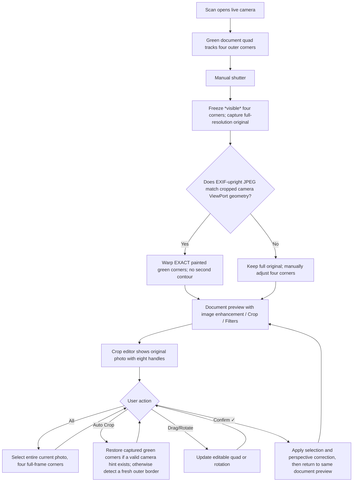

# CamScanner reference video → DocScanner camera-scan workflow

**Source inspected:** user-supplied `SVID_20261115_081448_1.mp4`
(24.276 s, portrait screen recording, received 15 Nov 2026).

**Scope:** `Scan → Camera → shutter` only. **Do not modify** the existing
`Scan → Import Images` or `Scan → Import Files` workflow, online-first
image detection or its gallery review and filters.

## What the supplied CamScanner video actually shows

| Video segment | Visible behavior |
| --- | --- |
| ~3–5 s | Live camera shows a **green quadrilateral** tracking the outside of a small, vertically oriented business card on dark blue fabric. A manual shutter is available. |
| ~6–8 s | Manual capture enters the document's **editing/preview screen** with one page, enhancement presets and **Crop**; some blue material is still visible near the lower edge of the displayed card. |
| ~15–16 s | Opening Crop displays the **uncropped photo** with the green eight-handle quadrilateral around the card. Bottom actions: **Left, Right, Auto Crop, All**; cancel and check mark are separate. |
| ~16.9–17.5 s | Tapping **All** expands the green handles to the four corners/edges of the **whole photograph**, *including the blue fabric*. |
| ~18 s and ~21 s | Tapping **Auto Crop** returns the handles to the small card boundary. The video alternates **All ↔ Auto Crop** repeatedly. |

The video does **not** establish CamScanner's private detection algorithms,
the precise sensor crop transform, or guaranteed pixel-perfect auto-crop on
every camera/device. All undocumented internals below are independent
DocScanner implementation decisions.

## Required user-facing state machine

## Behavior contract

1. **Live overlay:** draw the document's **outer** four corners in green,
   not the person's name/table or background. Keep normal manual shutter.
2. **Capture:** snapshot the *smoothed, visible Flutter quad* together with
   the camera frame orientation and dimensions. Save the source bitmap before
   warping. Analyze only the CameraX ViewPort cropRect; do not expire bound
   orientation after a short timeout. If JPEG and preview ViewPort aspect or
   orientation cannot be reconciled, never irreversibly crop.
3. **Geometric crop:** if the JPEG and analysis share the CameraX ViewPort
   and upright aspect ratio, warp exactly the painted shutter-green quad.
   Do not gate this on pixel-border colour or replace it with a still contour.
   Save the raw original before filtering the cropped output.
4. **Unmatched geometry:** retain the complete original and open manual
   four-corner editing; never invent a 90/270 turn or silently crop an inner
   table. A mismatched still rectangle is not the captured green outline.
5. **Crop editor actions:** **Left** and **Right** rotate; four corner plus
   four edge-midpoint handles drag; **All** sets
   `[(0,0),(1,0),(1,1),(0,1)]` for the **current photograph only**;
   **Auto Crop** restores the captured green camera outline if present,
   otherwise requests a detector pass. **✓** applies the selected image;
   **×** cancels without altering it. A whole-image selection with no
   rotation preserves original bytes rather than recompressing needlessly.
6. **Batch pages:** a separate 'Apply crop to all pages' action may remain in
   the top menu. It must not overload or change what the bottom **All**
   button does.
7. **Final preview:** one accepted scan is one page. Editing, rotating or
   cropping returns to the same page; no redundant
   `Retake / Adjust corners / Next` gate.

## Source-code mapping

| Stage | Implementation |
| --- | --- |
| Visible quad snapshot | `third_party/doclens/lib/src/controller.dart` |
| Capture and JNI parameters | `third_party/doclens/lib/src/method_channel_platform.dart`; Android `DoclensPlugin.kt` |
| Native still verification / perspective warp | `ScannerSession.kt`, `StillCaptureCropSafety.kt`, `ImageWarper.kt` |
| Camera-only fallback to manual crop | `lib/src/screens/camera_screen.dart`, `lib/src/services/document_edges.dart` |
| Eight-handle editor / All / Auto Crop | `lib/src/screens/batch_crop_screen.dart` |
| Single-page crop All | `lib/src/screens/crop_screen.dart` |

## Regression checklist

- White small business card on dark cloth: native verified crop selects
  the **green** edges, not fabric or a large still-image rectangle.
- Portrait preview + sideways JPEG: compare candidates after rotation;
  incompatible still dimensions go to safe manual editing.
- Interior printed box or full-image sentinel is rejected as an automatic
  document boundary.
- `All → Auto Crop → All → Auto Crop` alternates between whole image
  and captured card bounds, with eight handles responding each time.
- Tapping `Done` with All and no rotation preserves all source pixels.
- Single Scan never becomes an empty batch; image/file imports keep their
  existing behavior.
- Real Android/CameraX tests on the user's device are still required to
  establish screen-to-still alignment. CI geometry tests alone do not
  prove pixel-accurate scanning.
