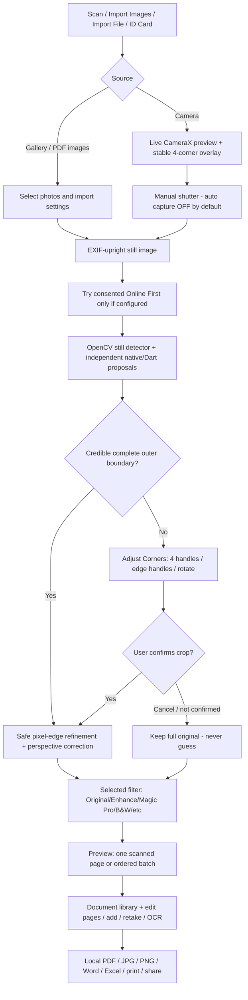

# DocScanner scan workflow — CamScanner-style user journey

> This document defines **DocScanner's implementation**, reconstructed from
> observed capture/edit screens, publicly inspectable APK structure and the
> user's comparison videos. CamScanner's private internal runtime sequence,
> model thresholds and proprietary source code are not known or reused.
> Matching UX and output quality is a goal, not a verified equivalence.

## Pipeline

## Entry modes

### Single scan
1. Camera opens with a stable rectangular overlay. Manual shutter is the
   default; camera auto-capture is OFF unless explicitly switched on.
2. The captured full-resolution upright original is retained.
3. Re-detect corners from the captured still rather than reusing a stale
   preview outline. Prefer complete paper/card borders to internal labels.
4. Apply a reliable perspective crop; if uncertain, open Adjust Corners
   and keep the full original on Cancel or unconfirmed handles.
5. Apply the selected filter to the cropped output, then show **one page** in
   the document editor. Rotate, crop, retake, extract text and export remain
   available. The original stays available for correction where supported.

### Batch scan / Import Images
1. Select photos; reorder/selection follows original selected order.
2. When Auto Crop is checked, detect each photo using the same still-image
   boundary policy. At most two auto-crop operations run concurrently.
3. High-confidence pages advance directly. Only uncertain pages open the
   multi-page Adjust Corners screen. Each page has independent handles,
   Auto Crop retry, rotation and page navigation.
4. Confirmed manual corrections replace the corresponding **working output**
   only; canceled/unmodified pages retain the originals. No photo disappears.
5. Enhancement applies **after** perspective cropping, with document-only
   bleaching disabled for uncropped backgrounds. The ordered results open
   the existing multi-page document grid and editing/export tools.

### ID card / Driver license / Bank card
1. The separate Front/Back (two-sided) workflow remains in `IdCardScreen`.
2. Crop/detect with `preferIdCardBounds=true`, not a forced A4 aspect ratio.
3. Never substitute an inner name/portrait rectangle for the entire card.
4. Users may correct each source side, rotate, enhance and compare.
5. Complete two-sided documents are arranged onto one A4 output through the
   existing `IdCardPageComposer`, with the selected template maintained.

## Runtime ownership

| Stage | Current implementation |
| --- | --- |
| Live overlay / CameraX | `third_party/doclens/android/src/main/kotlin/dev/doclens/doclens/ScannerSession.kt`, `OpenCvBoundaryAdapter.kt` |
| Still-image boundary proposals | `QuadDetector.kt`, `NativePageScanner.kt`, `lib/src/services/offline_document_contour.dart` |
| Safe contour selection | `lib/src/services/document_edges.dart` |
| Pixel edge refinement | `lib/src/services/quad_edge_refiner.dart` |
| Source/crop/review state | `lib/src/services/scan_workflow.dart` |
| Uncertain four-corner review | `lib/src/screens/batch_crop_screen.dart` |
| Gallery orchestration | `lib/src/screens/gallery_import_review_screen.dart` |
| Camera orchestration | `lib/src/screens/camera_screen.dart` |
| Perspective correction | `ImageWarper.kt` and `lib/src/services/image_processor.dart` fallback |
| Enhancement | `lib/src/services/image_processor.dart`; optional independent `libds_pagescanner.so` native pathway |
| Preview and edit tools | `lib/src/screens/document_screen.dart`, `document_detail_screen.dart` |
| Two-sided ID composer | `lib/src/screens/id_card_screen.dart`, `lib/src/services/id_card_page_composer.dart` |
| Local document persistence | `lib/src/storage/document_store.dart`, `HomeShell` |
| Export tools | `lib/src/services/document_export.dart` and individual Office/PDF services |

## Durable source preservation

A saved page now has two different editing references:

- `path`: currently displayed scan (crop + enhancement/edit).
- `originalPath`: perspective-corrected, unfiltered baseline so changing
  Enhance/Magic Pro/B&W never accidentally removes the crop.
- `rawSourcePath`: separate, full upright original camera/gallery image,
  stored in the app's private file library. Reopening Adjust Corners uses
  this image and can recover a clipped page header or ID photograph.

The optional `rawSourcePath` field is backward-compatible: old documents
without it still use their current image. Gallery import and normal CameraX
capture now pass original files into `DocumentStore.createFromPaths`.
The separate ID-card A4 composite flow has its own source-side editor;
a saved composite is not yet a lossless two-source ID project.

## Hard invariants

- **Never cut away uncertain content**. If valid four outside corners are
  unavailable, offer adjustment or preserve the original untouched.
- **No fabricated corner coordinates**. Strong printed table lines and
  notebook/holder outlines must not override a verified outer boundary.
- **Crop before enhancement**. Never use strong paper whitening on a raw
  background if the page has not been cropped. Preserve explicit Original.
- **Preserve page count and source order**. Do not duplicate/drop pages.
- **No invisible uploads**. Online First requires a saved user opt-in and a
  private HTTPS endpoint; otherwise local processing continues.
- **No proprietary JNI invocation**. User-provided CamScanner binaries are
  optional investigation-only and OFF in normal APKs; the app uses its own
  C++ engine, Kotlin/OpenCV and Dart filters.
- **No save notification for intermediate edits**. Notify only when the
  existing document save/export behavior calls for it.
- **Stable UI**. No hidden bottom controls or camera screen leaks while a
  full-screen crop editor owns navigation.

## What is implemented in this change

- Added typed `ScanWorkflowBatch` and `ScanBoundaryState` so every
  imported page is explicitly cropped, needs review, or intentionally original.
- Gallery and camera paths open `BatchCropScreen` for uncertain stills
  before enhancement/finish. The ID flag propagates to the crop detector.
- Canceled edits cannot overwrite source photos; manual adjustments use new
  temporary output files.
- Auto Crop disabled continues to use the original without prompting.
- Added workflow policy tests. Existing image, contour, OCR and PDF tools
  are unchanged.

## Validation still required

- Run `flutter analyze` and `flutter test` in GitHub Actions.
- Build ARM64 APK, verify `libds_pagescanner.so` packaging, then test on
  real Android hardware.
- Compare captured **identical originals** against CamScanner output across
  A4, legal, skewed page, faint border, patterned background, gold NID on
  ruled paper, reflective sleeve, glare, shadow and low-light scenes.
- Record four-corner localization error, false-crop rate, OCR legibility and
  visual quality, not just number of recognized contours.
- Device testing and measured CamScanner-equivalent accuracy are **not
  established** by this workflow definition.
